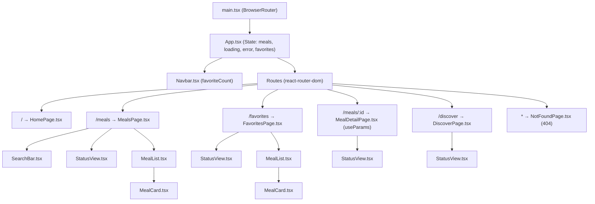

# Architecture — מבנה הרכיבים וזרימת המידע

מסמך זה מתאר את ארכיטקטורת הרכיבים, הניתוב (React Router) וזרימת הנתונים (State & Props) באפליקציית **Recipe Explorer**.

---

## 1. תרשים עץ הרכיבים (Component Tree)

---

## 2. חלוקת אחריות בין הרכיבים

| קובץ | תפקיד | State פנימי | Props עיקריים |
|------|--------|-------------|---------------|
| `src/App.tsx` | רכיב האב: מבצע `fetch` מ-TheMealDB API, שומר מועדפים ב-`localStorage`, ומגדיר את כל הנתיבים ב-`<Routes>`. | `meals`, `loading`, `error`, `retryKey`, `favorites` | — |
| `src/components/Navbar.tsx` | סרגל ניווט עליון קבוע עם `NavLink` לכל העמודים ומונה מועדפים חי. | אין | `favoriteCount: number` |
| `src/components/HomePage.tsx` | עמוד הבית (`/`): הסבר על האפליקציה, יתרונות, וטעימה של 3 מנות מומלצות. | אין | `meals?: Meal[]` |
| `src/components/MealsPage.tsx` | עמוד הקטלוג (`/meals`): מנהל את מצב החיפוש והסינון ומציג את `SearchBar` ו-`MealList`. | `searchTerm`, `selectedCategory`, `showOnlyFavorites` | `meals`, `loading`, `error`, `onRetry`, `favorites`, `onToggleFavorite` |
| `src/components/MealDetailPage.tsx` | עמוד פרטי מתכון (`/meals/:id`): קורא את ה-`id` מהכתובת באמצעות `useParams` ומציג מצרכים, הוראות ויוטיוב. | אין | `meals`, `loading`, `error`, `onRetry`, `favorites`, `onToggleFavorite` |
| `src/components/FavoritesPage.tsx` | עמוד המועדפים (`/favorites`): מציג את כל המנות השמורות במועדפים עם אפשרות ניקוי. | אין | `meals`, `loading`, `error`, `onRetry`, `favorites`, `onToggleFavorite`, `onClearFavorites` |
| `src/components/DiscoverPage.tsx` | עמוד הפתעה וסטטיסטיקות (`/discover`): הגרלת מתכון אקראי ופילוח גרפי של קטגוריות ומטבחים. | `randomIndex` | `meals`, `loading`, `error`, `onRetry`, `favorites`, `onToggleFavorite` |
| `src/components/NotFoundPage.tsx` | עמוד 404 (`*`): מוצג בכל כתובת לא מוכרת ומאפשר חזרה לדף הבית או לקטלוג. | אין | — |
| `src/components/SearchBar.tsx` | רכיב טופס חיפוש דו-לשוני, סינון קטגוריה, סינון מועדפים ואיפוס. | אין | `searchTerm`, `onSearchChange`, `selectedCategory`, `onCategoryChange`, `categories`, `totalResults`, `onReset`, וכו' |
| `src/components/MealList.tsx` | מרנדר רשימת מתכונים באמצעות `.map()` עם `key={meal.idMeal}`. | אין | `meals`, `favorites`, `onToggleFavorite` |
| `src/components/MealCard.tsx` | כרטיס מתכון בודד המקשר אל `/meals/${meal.idMeal}` וכולל כפתור מועדפים (`stopPropagation`). | אין | `meal`, `isFavorite`, `onToggleFavorite` |
| `src/components/StatusView.tsx` | תצוגת מצב טעינה (Spinner) או שגיאת רשת עם כפתור ניסיון חוזר. | אין | `loading`, `error`, `onRetry` |

---

## 3. טיפוסי TypeScript (`src/types/meal.ts`)

כל הנתונים באפליקציה מוגדרים בטיפוסים חזקים ללא שימוש ב-`any`:
- `Meal`: מייצג אובייקט מתכון שמגיע מ-TheMealDB API.
- `MealsApiResponse`: מייצג את מעטפת התשובה `{ meals: Meal[] | null }`.
- `TranslatedTitle`, `EnrichedIngredient`, `StatEntry`, `MealStatsSummary`: טיפוסים עבור שכבת התרגום, המצרכים והסטטיסטיקות ב-`src/utils/translations.ts`.
